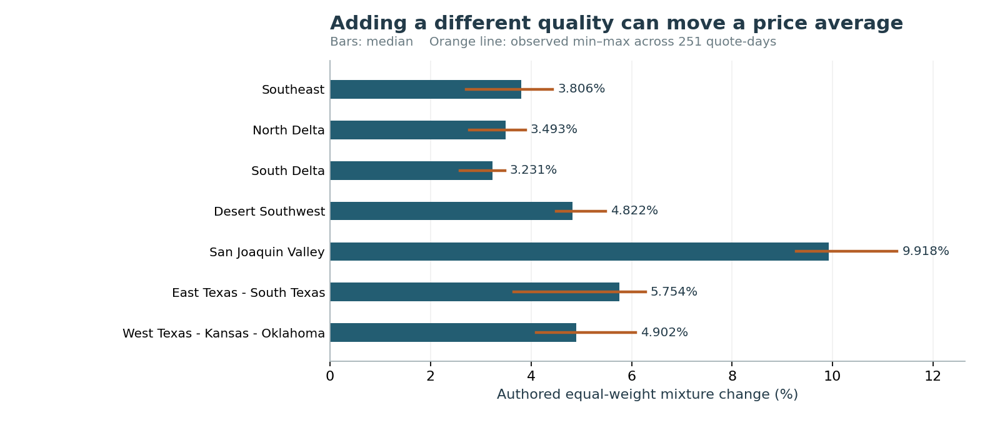

# Keep cotton quality in a price alert

A feed can add a different cotton quality while leaving the original quote unchanged. Averaging its rows can then trigger a false price alert. This repository keeps the quote identity explicit and returns an unavailable result when the intended comparison cannot be made.

**Controlled finding:** at the fixed 2% threshold, the grade-blind rule raises false alerts in all 1,757 zero-change expansion cases from the later source year. Matching the unchanged original quality removes that effect by construction. These are authored transformations of USDA historical quotations, not observed pipeline incidents, live anomaly precision or measured savings.



Start with the [six-page study](paper/manuscript.pdf), the [implementation exercise](exercise/README.md) or the local CLI:

```powershell
python src/cli.py examples/old-authored.json examples/new-authored.json
python src/cli.py examples/old-authored.json examples/new-authored.json --rule grade_blind
```

The examples are authored prices of 80 and 88, not USDA data. The returned changes are exactly `0` and `1/20`. Quote prices use native decimal strings; unknown identity is an unavailable result, not a negative prediction. No account, key or network access is needed for these commands.

## Evidence underneath

- [Protocol](PROTOCOL.md), [source binding and exposure](SOURCE_BINDING.md), [source qualification](SOURCE_QUALIFICATION.md) and [rights scope](DATA_RIGHTS.md).
- Three original USDA workbooks reconciled in 360,999 independent selected-cell/native-token conditions. The minimal factual projection retains 12,032 target-grade rows; 10,528 quotation keys form 5,264 eligible market/date pairs. All 21 market/year groups pass the fixed coverage minimum; [all exclusions and coverage](data/coverage.csv) remain available.
- [Development](DEVELOPMENT.md): 1,002 paired quote-days and 252,504 authored cases, independently checked. [Thirty-seven dependencies](DEPENDENCY_FREEZE.json) were committed before 1,757 later paired days and 442,764 authored cases across all seven later-year markets.
- Both identity rules, all 1/2/5% thresholds, signed changes, expansion states and identity failures remain in the [complete results](results). No model or threshold is selected or tuned. Conditional precision/recall describes the authored grid and its class shares.
- Twenty-eight finite fixtures, [original figures](figures), [source-bound manuscript displays](paper/display_ledger.json), [as-run versus canonical container evidence](EVIDENCE_CONTAINERS.md) and [current local review](REVIEW_RECEIPT.json). Exact remote checks are visible in [the pull request](https://github.com/S3R3Bii/cotton-grade-price-alerts/pull/2) and [Actions](https://github.com/S3R3Bii/cotton-grade-price-alerts/actions).

## Reproduce the bounded study

The public offline replay uses the committed minimal spot-quotation projection, separate regenerated outputs and exact CSV/JSON-content comparisons. It retains the original compressed inputs and all frozen bytes:

```powershell
python src/reproduce.py
```

Use Python 3.12 and `python -m pip install -r requirements.txt` for the source readers, figure regeneration and PDF checks. The comparison CLI and offline numerical replay also run with Python 3.10. Original-workbook reconciliation is a separate optional step requiring the recorded exact snapshots: `python src/verify_source.py --private-dir <original-workbook-folder>`. Current downloads can differ from the captured hashes; they are not silently substituted. [LaTeX source](paper/main.tex) and three figure PDFs accompany the paper.

## What to do with this

Preserve market, report date, unit, full quality definition and the other-quality convention before comparing quotes. Reconcile unavailable identities instead of silently averaging new series. A live integration still needs versioned mappings, arrival monitoring, independently labeled incidents and shadow evaluation before assigning precision or choosing an operating threshold.

USDA's 2025 format announcement motivates the failure mechanism; older reports already list 31/3/35, while the announced quality is 31/3/36. The benchmark does not reconstruct actual transition incidents. Source quotations are market-grid values, not independent transactions. Historical Texas-region definitions differ and remain explicit. There is no forecast, trading recommendation, causal result, new estimator, deployed service, peer review or measured operational benefit. This independent program manuscript is public; separate formal-publication projects remain excluded.
